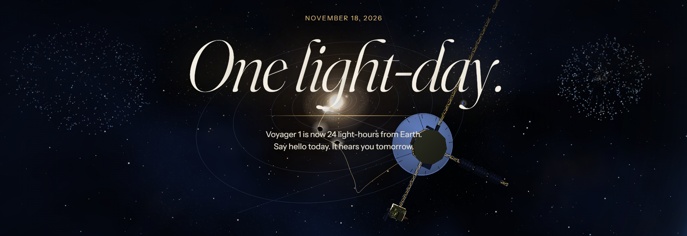

<div align="center">

# Voyager 1 · One Light-Day

### *Still going. Still talking.*

A 3D tribute to **Voyager 1** as it reaches **one light-day** from Earth on **November 18, 2026**.
Ride the spacecraft's route through the solar system, watch the live countdown, send it a message, and witness the moment it crosses 24 light-hours.

[](https://v1lightday.pages.dev)




*A tribute to Voyager 1, from Arnav Rajpurohit.*

</div>

---

## The idea

Launched in 1977, Voyager 1 is the farthest human-made object in existence. On November 18, 2026 it reaches a distance where light itself needs a full day to cross the gap: **one light-day**, about **25.9 billion km** (roughly 173 AU).

That means a message sent to it today arrives tomorrow, and any reply takes another day to come back. This site is a small, cinematic way to feel that distance.

## Features

| | |
|---|---|
| **Flight through the solar system** | A 20-second opening flight starts at Earth, follows Voyager's path past Jupiter and Saturn, crosses the heliopause and settles beside the spacecraft. Captions mark the launch, both flybys and the crossing into interstellar space. |
| **A 3D Voyager 1, built in code** | The 3.7 m high-gain dish, the ten-sided body in crinkled gold foil, the Golden Record, three finned RTGs on their boom, the scan platform, the 13 m magnetometer boom and the long plasma-wave antennas. All of it is generated from primitives, with no model files. |
| **A procedural solar system** | An animated Sun, eight planets, Saturn's rings, orbit lines, the asteroid belt, the Kuiper belt and the heliopause shell. Earth has clouds, ocean glint and city lights, all made in shaders. |
| **Live countdown** | Counts down to the milestone, then counts up the time since. The milestone is **5:16 a.m. EST = 10:16 UTC = 3:46 p.m. IST**. A scrolling bar shows that instant in major time zones. |
| **Live telemetry** | A distance counter ticks forward at Voyager's speed (about 17 km/s). |
| **Send Voyager a message** | Type a message and watch it travel the beam as a glowing packet. The page shows when it would arrive, with a live countdown. |
| **The celebration** | When the countdown hits zero the page turns into a cinematic screen: a shockwave from Voyager, choreographed firework salvos (peonies, rings and golden willows) across the whole sky, and the title revealed letter by letter. |
| **Interactive** | Drag to orbit, scroll or pinch to zoom, switch to a close-up view, or replay the flight and the celebration whenever you like. |

## Tech

- **HTML, CSS and vanilla JavaScript.** There is no framework, no bundler and no build step.
- **[three.js](https://threejs.org) r128** (WebGL), loaded from a CDN, with the bloom post-processing passes.
- **Custom GLSL shaders** for the nebula, stars, Sun, Earth, gas giants, Saturn's rings and the heliopause.
- **A custom GPU particle system** for the fireworks.
- **Fonts:** Fraunces, Instrument Sans and JetBrains Mono, from Google Fonts.

## Run it locally

The site is static, so there is nothing to install.

```bash
git clone https://github.com/<your-username>/v1lightday.git
cd v1lightday

# any static server works, for example:
python -m http.server 8000
# then open http://localhost:8000
```

Opening `index.html` directly also works in most browsers. You need an internet connection, because three.js and the fonts load from CDNs.

**Controls**

| Action | Desktop | Touch |
|---|---|---|
| Orbit Voyager | Drag | Drag |
| Zoom | Scroll | Pinch |
| Skip the opening flight | **Skip flight** button | **Skip flight** button |
| Close the celebration | **Keep watching** or `Esc` | **Keep watching** |

**Preview the finale without waiting for Nov 18:** open the site with `?demo` (for example `http://localhost:8000/?demo`). The countdown is replaced with a 32-second one, so the opening flight finishes and the celebration plays. You can also press **Replay the moment** at any time.

## Deploy to Cloudflare Pages

1. Push this repo to GitHub, with `index.html` at the top level.
2. In Cloudflare, open **Workers & Pages → Create → Pages → Connect to Git** and pick the repo.
3. Set the project name to `v1lightday`, leave the **build command empty**, and set the **output directory** to `/`.
4. Deploy. The site goes live at `https://v1lightday.pages.dev`.

Any other static host (GitHub Pages, Netlify, Vercel) works the same way.

## Project structure

```
v1lightday/
├── index.html          # page markup
├── css/
│   └── style.css       # layout, palette, celebration screen
├── js/
│   └── main.js         # the 3D scene, flight, HUD, fireworks, countdown
└── assets/
    ├── favicon.ico     # favicon files
    ├── favicon-32.png
    ├── favicon-180.png
    ├── favicon-192.png
    ├── v1_favicon.png  # original favicon image
    └── preview.png     # screenshot used at the top of this README
```

## The mission in numbers

| | |
|---|---|
| Launch | September 5, 1977 |
| Jupiter flyby | March 5, 1979 |
| Saturn flyby | November 12, 1980 |
| Crossed the heliopause | August 25, 2012 |
| One light-day from Earth | November 18, 2026 |
| One light-day | about 25.9 billion km, or about 173 AU |
| Speed | about 17 km/s |

For the official, current numbers, see [NASA's Voyager 1 mission page](https://science.nasa.gov/mission/voyager/voyager-1/) and the [Voyager 1 "light-day" explainer](https://science.nasa.gov/mission/voyager/voyager-1/voyager-1-what-is-a-light-day/).

## An honest note on accuracy

This is an artistic tribute, not a simulation.

- Orbit distances are **compressed** (distance = 70 × AU^0.62) so the whole journey fits on screen, and the planets are drawn larger than life. The order and the relative layout are right, but the real scale is far too large to show.
- The Voyager 1 model is **stylized**. Its parts are real, but proportions and details are simplified, and the magnetometer boom is shown at its real length relative to the dish.
- The distance counter is an **approximation** based on a fixed speed from the milestone distance. It is not a live NASA reading.
- The route is a smooth illustration through the right planets and dates, not Voyager's exact trajectory.

## Credits

- **NASA / JPL-Caltech**, for the Voyager mission and for the facts this tribute is based on.
- **[three.js](https://threejs.org)**, for the 3D engine.
- Everything you see in 3D (the spacecraft, the planets, the stars and the fireworks) is generated by the code in this repo.

## License

Released under the [MIT License](LICENSE). Voyager, NASA and JPL names belong to their owners, and this project is not affiliated with or endorsed by NASA.

---

<div align="center">

**A tribute to Voyager 1, from Arnav Rajpurohit.**

*It left in 1977 carrying a golden record. It is still going.*

</div>
